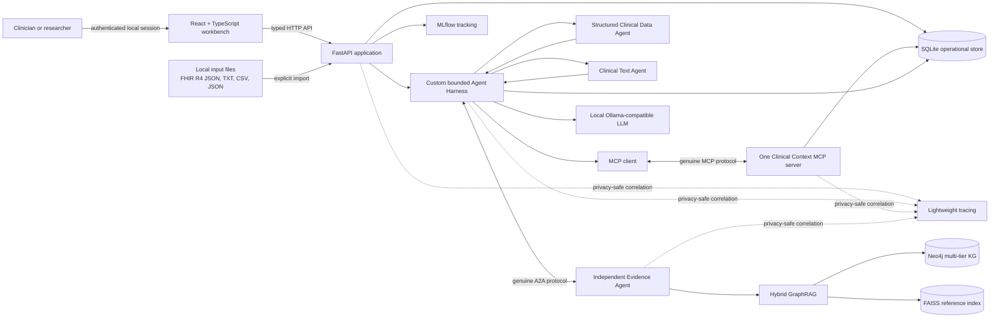
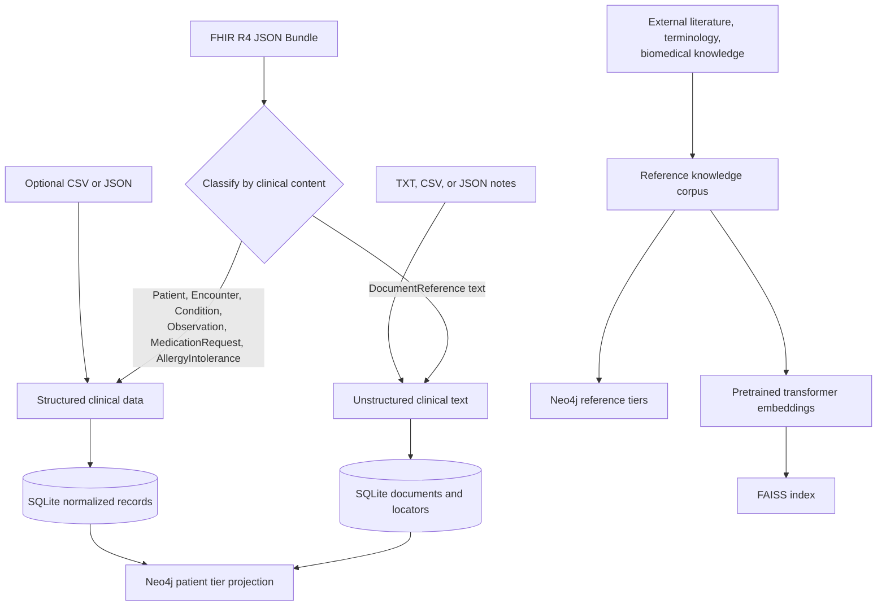
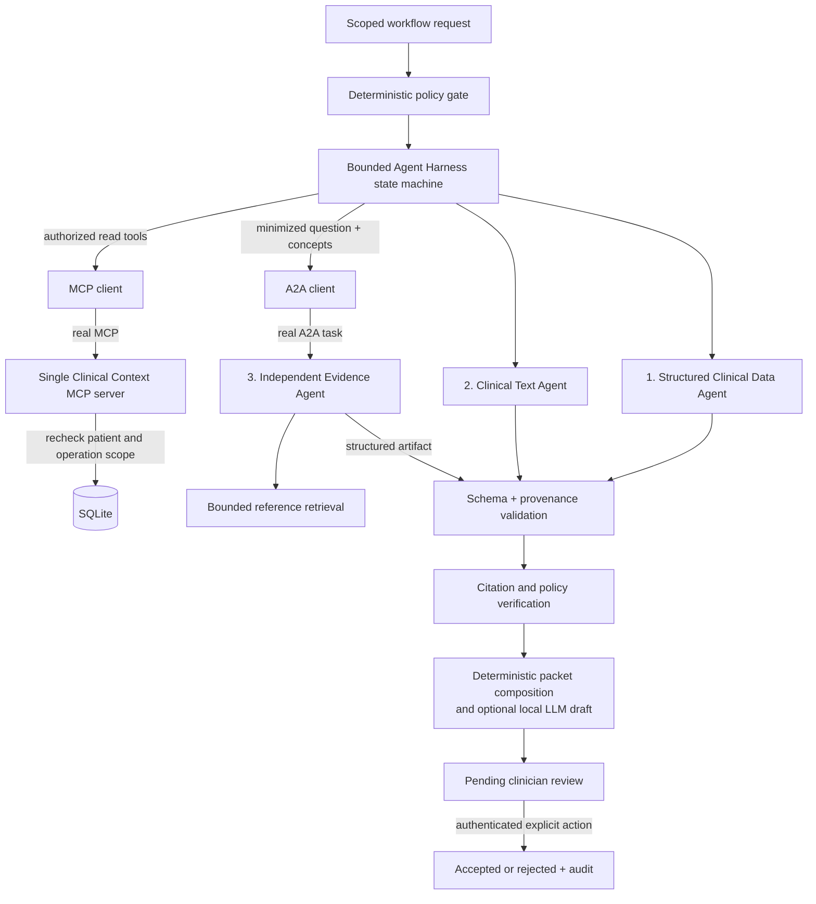
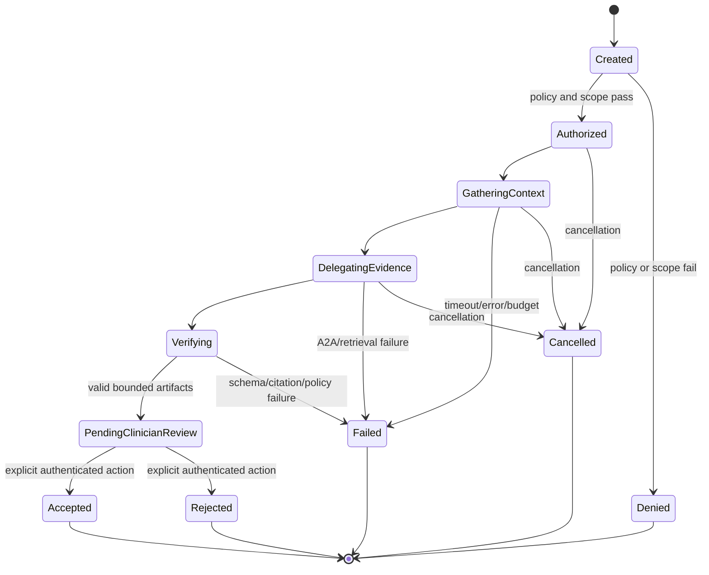

# MAGE-Med PoC Architecture

## 1. Architectural goals

The architecture supports a local-first, reproducible, source-grounded clinical decision-support PoC using exactly two patient-data modalities. It prioritizes provenance, patient isolation, bounded agent behavior, genuine MCP/A2A interoperability, explicit degraded states, and clinician review over infrastructure breadth.

## 2. System context

The reference corpus feeding Neo4j and FAISS is separate from patient inputs. No patient text is sent to a hosted service by default.

## 3. Two modalities and derived artifacts

The supported medication representation is a normalized `MedicationRequest`
summary. Local FHIR ingestion also accepts `DocumentReference`; its embedded
text is unstructured clinical text, not a third modality. FHIR is a format; the
reference corpus is not a patient modality; Neo4j and FAISS contents are derived
projections.

## 4. Component responsibilities

### 4.1 Frontend

The React/Vite/Tailwind workbench provides patient selection, longitudinal timeline, note/source views, evidence inspection, graph/provenance exploration, agent/tool trace, service status, and explicit accept/reject review. It consumes real backend contracts and must render loading, empty, invalid, unauthorized, unavailable, degraded, and contradictory states. It never fabricates metrics or approval state.

### 4.2 FastAPI application

FastAPI is the external application boundary. It validates Pydantic contracts, authenticates local users, enforces patient and purpose scope, coordinates imports and workflows, serves read models, and records review actions. Route handlers remain thin; domain services own validation, storage, retrieval, and workflow behavior.

The implemented common clinical-data domain service assembles patient-scoped
longitudinal read models from canonical SQLite tables. It covers encounters,
conditions, observations, medication requests, allergies, and note references;
preserves source terminology, units, event/recorded/import times and provenance;
and supplies bounded filters and paging. Clinical event time controls ordering,
with explicit recorded/import fallback labels. Source `dataAbsentReason` remains
missing data and is never rewritten as a negative finding. See
`docs/CLINICAL_DATA_ACCESS.md` for the operational contract.

### 4.3 SQLite operational store

SQLite stores normalized structured records, document metadata/text locators, import manifests, provenance, users/roles for the PoC, workflows, agent artifacts, review state, audit events, and projection/index metadata. Migrations, foreign keys, transactions, and indexes are required. It is the operational source of truth; derived Neo4j and FAISS state must be rebuildable.

### 4.4 Neo4j multi-tier knowledge graph

Neo4j stores exactly four logically separated tiers:

- **temporal patient-fact tier:** authorized patient identity, facts, notes, and temporal relationships;
- **biomedical concept tier:** terminology and concept links;
- **evidence/reference/provenance tier:** literature/guideline documents, chunks, source artifacts, and provenance links;
- **nonconfirmed hypothesis/inference tier:** generated propositions and inference-run metadata, never confirmed clinical facts.

Every clinical node or relationship has a stable ID, tier, patient scope where applicable, source locator, assertion class, temporal metadata, and creation provenance. Only allowlisted parameterized queries are available to application services and agents.

The implemented repository applies named idempotent Community-compatible
constraints and indexes, validates node/edge invariants with Pydantic, and uses
fixed parameterized templates. `ASSOCIATED_WITH` explicitly records
`causal=false`; hypotheses and supporting/contradicting evidence edges remain
nonconfirmed and unverified. See `docs/GRAPH_DESIGN.md` for labels, relations,
migration behavior, and current projection limitations.

The implemented canonical graph synchronizer reads normalized SQLite records and
atomically replaces only the derived temporal patient projection. Stable canonical
UUIDs are reused; ownership follows Patient → Encounter → fact when a verified
encounter link exists, otherwise Patient → fact. Every fact links to its immutable
SourceArtifact. Direct `MAPS_TO` edges reproduce only source-supplied terminology
system/code pairs. No narrative concept extraction or inferred biomedical
association occurs. Fixed patient-scoped queries provide neighborhood, labs,
conditions, note provenance, and visualization JSON. See `docs/GRAPH_SYNC.md`.

### 4.5 FAISS and embeddings

A pinned pretrained transformer embeds reference-corpus chunks. FAISS provides local vector similarity retrieval. The persisted index is tied to a manifest containing corpus checksum, chunker version, embedding model/revision, dimensions, normalization, index configuration, and artifact checksum. Patient records are not silently added to the reference index.

### 4.6 Hybrid GraphRAG

Hybrid GraphRAG combines:

1. structured constraints and temporal patient concepts authorized for the workflow;
2. allowlisted Neo4j traversal through reference concepts/evidence;
3. FAISS vector retrieval over the reference corpus;
4. deterministic rank fusion and source-aware filtering;
5. explicit supporting, contradicting, missing, and stale evidence groups.

Retrieval scores retain their native meaning and are never presented as clinical probabilities. Every result resolves to an exact stored text span.

### 4.7 Local generation

An adapter talks to an explicitly configured local Ollama-compatible endpoint. It performs capability/availability checks and records model identity, parameters, prompt/schema version, latency, and outcome. Outputs must conform to Pydantic schemas and cite only supplied source IDs. If inference is unavailable or invalid, the workflow reports that state without canned replacement output.

## 5. Agent topology and permissions

The custom harness is an explicit state machine with limits for steps, wall time, retries, tokens, retrieved items, and tool calls. It owns cancellation, idempotency, correlation IDs, artifact validation, verification, and review transitions. It is not an agent.

Agents cannot access databases, filesystems, networks, models, or tools except through harness-provided bounded adapters. They cannot spawn agents, grant permission, mutate clinical source records, approve output, prescribe, order, or issue a final diagnosis.

The Structured Clinical Data Agent and Clinical Text Agent run inside the application boundary under the harness. The Evidence Agent starts independently and uses the genuine A2A protocol with capability discovery, task states, structured artifacts, errors/cancellation, propagated scope, and trace correlation.

## 6. MCP boundary

There is exactly one MCP server: the Clinical Context MCP server. Its narrow, typed, read-only tools are finalized during the MCP milestone and may include scoped timeline retrieval, supported structured-record retrieval, and note/source retrieval. Tool names and schemas are versioned.

The harness authorizes before invocation; the server independently authenticates and rechecks patient, purpose, and operation scope. The server exposes no arbitrary SQL/Cypher, general filesystem or network access, shell execution, mutation, prescribing, ordering, or approval tools. Acceptance requires SDK-based discovery and invocation over the real protocol, including denial and unavailable-server cases.

## 7. A2A boundary

The Evidence Agent is the one independently running A2A agent. It publishes a versioned Agent Card/capability declaration and accepts a minimized evidence-retrieval task. Default payloads contain a research question, authorized non-identifying clinical concepts, constraints, and correlation/scope claims—not patient narratives or a wholesale chart.

It returns structured artifacts containing query interpretation, exact evidence source IDs and spans, ranks/scores, supporting/contradicting groups, limitations, corpus/index versions, and status. Both caller and agent validate scope. A direct Python function or ad hoc REST endpoint does not satisfy this design.

## 8. Workflow and review state

Retries are bounded and idempotent. Failures and service unavailability remain visible. No transition automatically accepts a recommendation.

## 9. Provenance model

Every import has a manifest and checksum. Each normalized record or document links to its source file/import, FHIR resource and ID when applicable, original locator/content hash, clinical and recorded times, mapping/parser version, and ingestion run. Derived assertions add assertion class, model/agent/prompt version where applicable, supporting source IDs, creation time, and verification/review status.

Reference evidence preserves corpus, document, chunk, publisher/source, version/date, section/page if available, license, checksum, ingestion/chunking/embedding versions, and exact stored span. Citation verification is deterministic against that span.

### 9.1 Canonical clinical model version 1.0.0

Both patient-data import paths normalize into the same Pydantic contract
family before persistence. The contract covers `Patient`, `Encounter`,
`Condition`, laboratory `Observation`, `MedicationRequestSummary`, `Allergy`,
`ClinicalNote`, `ClinicalAssertion`, `SourceArtifact`, and `ImportManifest`.
FHIR R4 is represented only as a `SourceFormat`; modality remains either
`structured_clinical_data` or `unstructured_clinical_text`.

Every normalized clinical fact has a UUID internal ID, exact source artifact and
locator, optional patient/encounter scope, separate event and recorded times,
import time, parser/run provenance, and assertion type. `SourceArtifact` retains
the immutable original JSON or text. FHIR-origin facts additionally retain the
resource type and original resource ID. Date-only clinical times are not coerced
into false timestamp precision.

Assertion type (`observed`, `extracted`, `model_inferred`, `hypothesized`,
`clinician_confirmed`, or `clinician_rejected`) is distinct from verification
and lifecycle status.
Confidence is accepted only for extracted, model-inferred, or hypothesized
assertions. The contract requires `clinician_rejected` assertions to have
rejected verification status and forbids that verification state for other
assertion types. This separation prevents a source fact, model claim, and
clinician decision from being conflated.

SQLite tables mirror these contracts through Alembic revision
`0004_clinical_text`. Foreign keys bind normalized records to immutable source
artifacts and patient/encounter context. A source-resource mapping preserves each
FHIR resource JSON, `fullUrl`, source key, normalization outcome, and stable
normalized target. SQLite remains operational truth; no graph projection or
automatic schema creation is introduced by the importer.

### 9.2 Local FHIR R4 importer

The importer is a module used by both the CLI and FastAPI, not an independently
deployed microservice. It parses a local Bundle or individual resource with
`fhirclient==4.2.0` base R4 models, applies project invariants, resolves only
explicit unique references, normalizes through the canonical Pydantic boundary,
and commits artifact, manifest, mappings, and records atomically. Exact checksum
replays are idempotent and stable source identities update without duplication.
Normalized IDs and source keys are scoped by the explicit dataset ID so
unrelated sources that reuse relative FHIR IDs are not merged.
Unsupported and unusable resources remain visible in the report. This validation
does not evaluate profiles, implementation guides, or terminology conformance.
See `docs/FHIR_INGESTION.md` for the operational contract.

### 9.3 Clinical text importer and retrieval

TXT, CSV, JSON, and FHIR `DocumentReference` content normalize into
`ClinicalNote` records in the unstructured clinical-text modality. The source
artifact retains the exact decoded input; notes retain separate original and
deterministically cleaned text. Stable chunks reference exact cleaned-text
character offsets and checksums. Optional section headings are deterministic
metadata, not model extraction.

Direct note linkage accepts only existing canonical patient/encounter UUIDs.
Missing mappings keep notes unlinked; mismatched patient/encounter mappings clear
both links. FHIR linkage uses the same explicit reference resolver as structured
resources. Patient context retrieval is server-scoped by patient UUID and returns
source summaries for structured records plus linked notes/chunks.

FHIR attachment URLs are read only when they are relative `.txt` paths resolving
beneath an explicitly configured local root. Absolute, traversal, symlink escape,
external, missing, non-text, oversized, or invalid-encoding attachments produce
an unavailable outcome with the original resource preserved. No URL fetch or
content execution exists. See `docs/CLINICAL_TEXT_INGESTION.md`.

## 10. Security and privacy model

- Local authentication and role/purpose checks protect imports, patient views, workflows, and review actions.
- Patient scope is enforced in FastAPI, domain repositories, MCP, graph queries, and workflow artifacts.
- Clinical content is excluded from general logs, MLflow parameters/tags, and traces; correlation uses opaque IDs.
- File imports use size/type limits, safe parsing, atomic transactions, allowlisted paths for local `DocumentReference` content, and no arbitrary URL fetching.
- External documents and model/tool results are untrusted. Prompt-injection defenses are enforced by data/tool separation, allowlists, schemas, bounded context, and post-generation verification.
- Secrets are environment-provided and never stored in prompts, artifacts, source control, or telemetry.

This is a PoC security posture, not a compliance certification.

## 11. Deployment and process model

The supported development topology is local processes, optionally coordinated by a minimal local container setup when introduced by a milestone. Required runtime processes for the successful full demonstration are the FastAPI app, frontend, Neo4j, independently running A2A Evidence Agent, MCP server, local Ollama-compatible service, and MLflow tracking. SQLite and FAISS are local artifacts with controlled paths. During component development or an outage, the application must expose an honest unavailable/degraded state rather than substitute generated output.

Every service exposes an actual health/capability status. The UI distinguishes ready, degraded, unavailable, and incompatible states. Ports and paths are configurable. CPU operation is preferred; model resource requirements and downloads must be disclosed.

## 12. Observability and evaluation

Lightweight tracing propagates one correlation ID across API, harness, MCP, A2A, retrieval, generation, and review without recording patient text. Audit events are separate, append-oriented domain records. MLflow tracks actual run configuration, manifests, metrics, artifacts, and outcome status.

Evaluation compares deterministic structured/vector baselines and the hybrid workflow on versioned synthetic questions and expected source sets. It measures retrieval, citation/provenance coverage, policy behavior, latency, errors, and review-state correctness without converting model confidence into clinical probability.

## 13. Architectural decisions fixed for the PoC

1. Exactly two patient modalities; FHIR is a format and the reference corpus is separate.
2. SQLite is operational truth; Neo4j and FAISS are derived, rebuildable stores.
3. Exactly three specialized agents; the Evidence Agent is the independently running A2A service.
4. Exactly one read-only clinical-context MCP server.
5. A custom deterministic harness, rather than an autonomous planning framework, owns policy and execution.
6. Local pretrained embeddings and a local Ollama-compatible LLM prevent default patient-data egress.
7. Source-grounded artifacts and explicit clinician review are required; unavailable components fail honestly.
8. The implementation is incremental across the 25 milestones in `IMPLEMENTATION_PLAN.md`; this architecture document does not authorize premature scaffolding.
