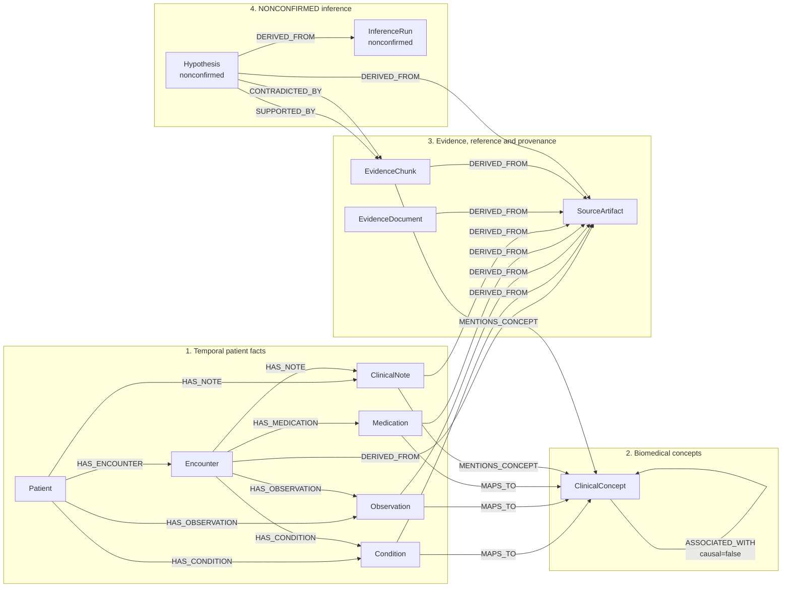

# Multi-tier Neo4j Graph Design

## Status and boundary

Neo4j is a versioned, rebuildable projection. SQLite remains the operational
source of truth. This milestone defines graph contracts, constraints, indexes,
idempotent writes, and bounded reads. Milestone 10 adds the deterministic patient
projection documented in `docs/GRAPH_SYNC.md`.

The repository exposes no method that accepts caller-supplied Cypher, labels,
relationship types, or property keys. Node labels and relationship structures
come from enums and fixed templates. Values are passed as Neo4j parameters.

## Four logical tiers

Every node also carries one tier label:

| Tier | Neo4j label | Concrete labels |
| --- | --- | --- |
| Temporal patient facts | `TemporalPatientTier` | `Patient`, `Encounter`, `Condition`, `Observation`, `Medication`, `ClinicalNote` |
| Biomedical concepts | `BiomedicalConceptTier` | `ClinicalConcept` |
| Evidence/reference/provenance | `EvidenceProvenanceTier` | `EvidenceDocument`, `EvidenceChunk`, `SourceArtifact` |
| Nonconfirmed inference | `NonConfirmedInferenceTier` | `Hypothesis`, `InferenceRun` |

`Medication` is the graph projection label for the canonical medication-request
summary; projection rules will retain request status, intent, authored time, and
source identity rather than implying administration.

## Required semantics

All nodes require stable `id`, `schema_version`, `kind`, `tier`,
`source_artifact_id`, `provenance_id`, `imported_at`, `assertion_type`, and
`verification_status`. Patient-related nodes additionally require `patient_id`.
Temporal facts may preserve `event_time` and `recorded_time`; missing event time
remains missing and is not replaced with import time in the graph.

All relationships require a stable ID, source/target kinds, source artifact,
provenance, creation time, assertion type, and verification state. Patient-related
edges require explicit patient scope. Cypher predicates check the patient ID on
both scoped endpoints, preventing an edge from connecting one patient's root to
another patient's fact.

Hypothesis and InferenceRun nodes accept only `model_inferred` or `hypothesized`
assertion classes and must remain `unverified`. Writes add
`confirmation_status="nonconfirmed"` and `clinically_confirmed=false`.
`SUPPORTED_BY` and `CONTRADICTED_BY` edges have the same nonconfirmed boundary.
Automatically extracted ClinicalConcept nodes cannot be marked verified.

`ASSOCIATED_WITH` always stores `causal=false`. It means only that an authorized,
provenance-bearing process recorded an association. It is never evidence of
medical causation.

## Schema migration and identity

Migration `0001_multi_tier_graph` uses named `CREATE ... IF NOT EXISTS`
statements and records its version in `GraphSchemaMigration`. A uniqueness
constraint on `GraphEntity.id` prevents a stable ID from being reused under a
different concrete label; `Patient.id` is separately constrained. Every allowed
relationship type has an ID uniqueness constraint. Indexes cover patient scope,
event time, source artifact, concept system/code, evidence document, and inference
patient scope.

Migration `0002_patient_projection` adds the `HAS_MEDICATION` relationship-ID
constraint and a projection-source index without rewriting the earlier migration.

Community Edition supports the uniqueness constraints used here. Property
existence/type constraints that require Enterprise Edition are intentionally not
claimed; Pydantic write contracts enforce required provenance and timestamps,
and all application writes must pass through the repository.

The schema syntax and driver behavior follow the official Neo4j documentation
for [idempotent constraints](https://neo4j.com/docs/cypher-manual/current/schema/constraints/create-constraints/)
and [parameterized `execute_query`](https://neo4j.com/docs/python-manual/current/query-simple/).

## Repository operations

- `initialize_schema()` applies static versioned migrations.
- `upsert_node(GraphNode)` performs an idempotent `MERGE` for an allowlisted kind.
- `upsert_relationship(GraphRelation)` validates endpoints and scope, then uses
  one parameterized relationship template.
- `get_patient_facts(patient_id, limit)` is a fixed, bounded, patient-filtered
  read over the four direct patient-fact relation types.

There is deliberately no arbitrary query, generic label, generic relationship,
delete, shell, network, or agent-facing graph method.

## Current limitations

- Deterministic SQLite-to-Neo4j patient projection, atomic replacement, and the
  initial scoped read queries are implemented in Milestone 10. Persisted stale-
  projection status and background scheduling remain deferred.
- Evidence corpus ingestion and exact reference spans belong to Milestone 11.
- No hypothesis or evidence content has been generated. Tests use only explicit
  synthetic IDs and metadata.
- Neo4j is not the authority for patient identity, clinician review, or source
  records.
