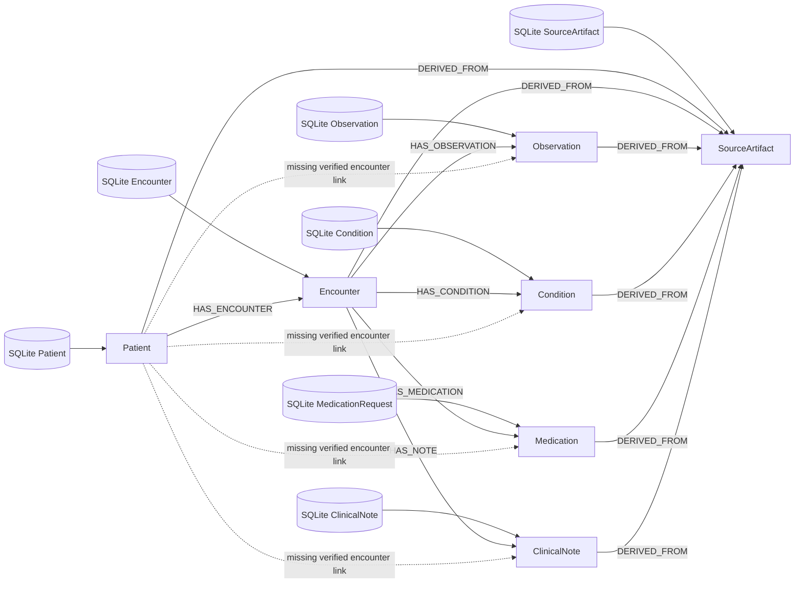

# Canonical SQLite to Neo4j Synchronization

## Boundary

SQLite remains the canonical operational store. Neo4j contains a deterministic,
deletable projection used for bounded traversal and visualization. A failed graph
sync does not alter SQLite. No graph query writes back to clinical records.

The synchronizer projects normalized FHIR and clinical-text records; it does not
parse FHIR again and does not extract concepts from narrative text. It creates no
model output, hypothesis, disease-to-symptom relation, or clinical conclusion.

## Projection mapping



When a fact has a verified encounter UUID belonging to the patient, the encounter
owns the fact edge. A fact with no encounter link is attached directly to the
patient. An encounter pointing outside the canonical patient scope aborts sync;
the synchronizer never guesses or silently reparents it.

FHIR `MedicationRequest` becomes a graph `Medication` node while retaining
request status, intent, authored time, source ID, and assertion class. It does
not imply dispensing or administration. The current core graph schema has no
Allergy node; canonical allergies remain in SQLite and the sync report counts
them as `skipped_allergy_count` rather than silently claiming projection.

## Identity, time, assertion and provenance

- Canonical normalized UUIDs are reused for Patient, Encounter, Observation,
  Condition, Medication, and ClinicalNote nodes.
- Patient source identifiers are preserved as flat `system|value` keys. Original
  FHIR resource type/ID and source locator remain node properties.
- Source event time and recorded time remain distinct. `event_time_key` is an ISO
  string used only for bounded temporal filtering; it does not replace the source
  temporal value or add false precision.
- Canonical assertion type is copied unchanged to every fact node and ownership/
  provenance edge. The schema continues to prevent hypothesis nodes from becoming
  confirmed clinical facts.
- Each patient-scoped node has a stable `DERIVED_FROM` edge to its SourceArtifact.
  Source metadata includes locator, format, media type, checksum, and synthetic
  flag, but not raw document or note content.
- Notes store metadata and a content checksum in Neo4j, not narrative text.

## Terminology rule

`MAPS_TO` is created only when the canonical source supplied both terminology
system and code. The target ClinicalConcept uses that exact system/code/version
and the edge records `mapping_basis=source_supplied_code`. No synonym expansion,
cross-ontology mapping, disease-to-symptom link, or text-derived concept is added.
Records without a complete source coding remain coded only by their preserved
source properties.

## Atomic rebuild and idempotency

`GraphSyncService` builds the complete projection in memory using deterministic
UUIDv5 relationship and concept IDs. Repository replacement runs in one managed
Neo4j write transaction:

1. delete only `TemporalPatientTier` nodes in the requested patient scope, or all
   such nodes for a full rebuild;
2. merge all projected nodes and edges;
3. remove only orphan `projection_source=sqlite` concepts and source artifacts;
4. commit all changes together, or roll everything back on failure.

Reference evidence and nonconfirmed inference tiers are not cleared by a patient
rebuild. Repeating the same sync produces identical IDs and counts.

## CLI

After applying SQLite migrations and importing local data:

```bash
uv run mage-med graph-sync --rebuild
uv run mage-med graph-sync --patient-id <canonical-patient-uuid>
```

The CLI initializes both graph schema migrations and prints actual patient, node,
relationship, concept, source-artifact, and skipped-allergy counts. Neo4j
connection failure remains a real command failure; no success is simulated.

## Read-only repository queries

All reads require a canonical patient UUID and use fixed parameterized Cypher:

- `get_patient_neighborhood(patient_id, limit)`
- `get_temporal_lab_facts(patient_id, date_from, date_to, limit)`
- `get_condition_history(patient_id, limit)`
- `get_note_provenance(patient_id, note_id)`
- `get_graph_json(patient_id, limit)`

Traversal predicates permit the scoped patient's nodes plus unscoped terminology
and provenance nodes; a path containing another patient's node is rejected. An
unknown patient or wrong-patient note lookup raises `GraphScopeError`. There is no
natural-language-to-Cypher or arbitrary-Cypher API.
